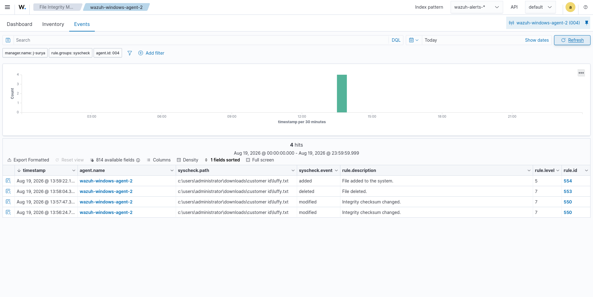
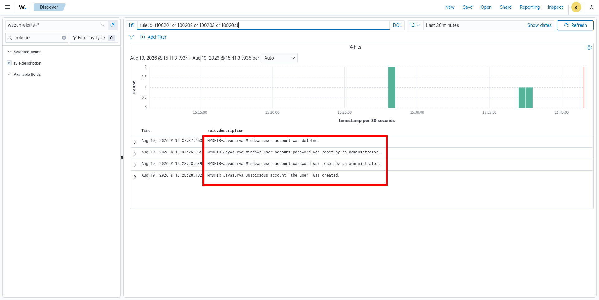
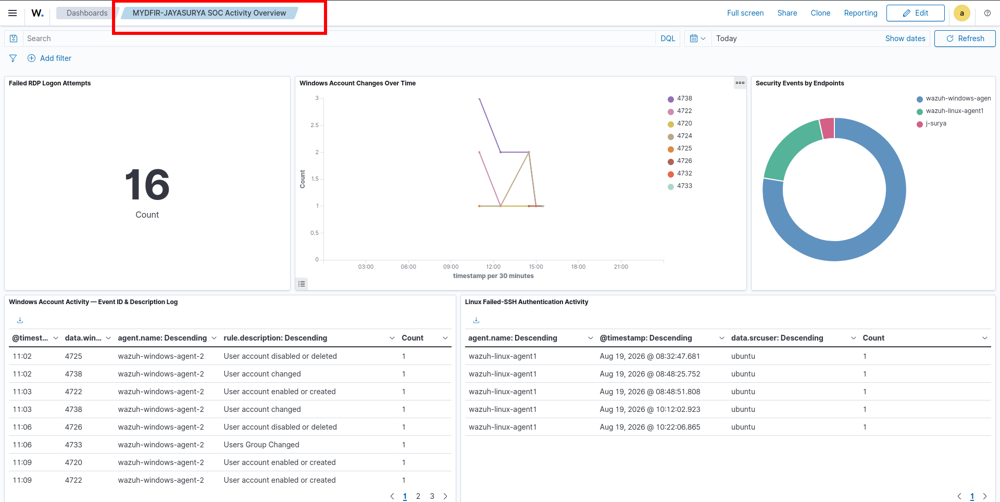
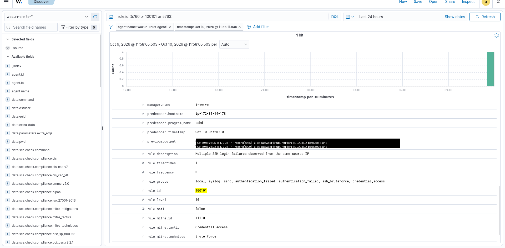
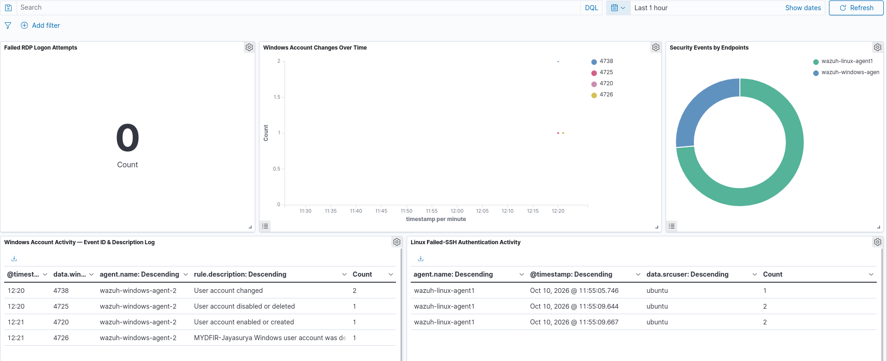
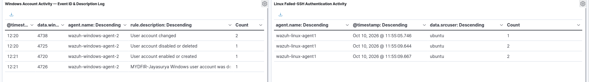

# Wazuh SOC Lab: Detection Engineering and Investigation

A hands-on SOC lab built while following the MyDFIR 7-Day SOC Challenge. A Wazuh manager, indexer and dashboard on a Debian laptop monitor cloud endpoints over a mesh VPN. The lab includes custom detection rules mapped to MITRE ATT&CK, file integrity monitoring, a custom dashboard and a written investigation report.

Credit to the [MyDFIR](https://www.youtube.com/@MyDFIR) SOC Analyst challenge and to Steven Mah for the exercise. This repo contains my own configs, results and write-up, not the course material. It includes only the work I captured evidence for — detections that are configured but untested are called out as such, not claimed as proven.

## Lab environment

| Component | Detail |
|---|---|
| Wazuh server | Manager, indexer and dashboard on a Debian laptop |
| Windows endpoint | Windows Server 2022 on AWS EC2, accessed over RDP (Remmina) |
| Linux endpoint | Ubuntu 24.04 on AWS EC2, accessed with SSH key pairs |
| Connectivity | Tailscale mesh VPN, because my home router restricts port forwarding |

Evidence was captured across two sessions: an initial walkthrough on August 19, 2026, and a focused re-test on October 10, 2026 aimed at validating detections (SSH brute force, account lifecycle events) that weren't fully proven the first time.

## Results

| Area | What happened | Evidence |
|---|---|---|
| Custom Windows rules | Rules 100202, 100203 and 100204 fired on live Windows events | [Screenshot 2](screenshots/02-custom-rule-alerts.png) |
| File integrity monitoring | A file added, modified, deleted and re-added in a watched folder produced rules 554, 550 and 553 | [Screenshot 1](screenshots/01-fim-events.png) |
| SSH brute force | Custom rule 100101 fired after repeated failed SSH logins from the same source IP, tested across two terminals | [Screenshot 4](screenshots/04-ssh-bruteforce-alert.png) |
| Account lifecycle | Event IDs 4720, 4722, 4724, 4725, 4726, 4732, 4733 and 4738 captured and matched by Wazuh's built-in Windows rules | [Screenshot 3](screenshots/03-soc-dashboard.png), [Screenshot 6](screenshots/06-windows-linux-panels.png) |
| Dashboard | Custom "MYDFIR-JAYASURYA SOC Activity Overview" with RDP, account-change, endpoint and SSH panels | [Screenshot 3](screenshots/03-soc-dashboard.png), [Screenshot 5](screenshots/05-dashboard-oct10.png) |
| RDP brute force (Aug 19 session) | 16 failed logons (Event ID 4625) recorded with Hydra against the Windows RDP service | [Screenshot 3](screenshots/03-soc-dashboard.png) |

## Custom detections

| Rule | Trigger | Level | MITRE ATT&CK |
|---|---|---|---|
| 100202 | Password reset by an administrator (4724) | 10 | T1098 |
| 100203 | Account deleted (4726) | 12 | T1531 |
| 100204 | Suspicious account `the_user` created (4720) | 12 | T1136 |
| 100101 | 3+ SSH auth failures from the same source IP within 120s | 10 | T1110 |

Details and rationale are in [`detections/rules.md`](detections/rules.md). The rule file is [`detections/local_rules.xml`](detections/local_rules.xml).

## Custom work in this lab

- Four custom rules with ATT&CK mappings and environment-specific alert text.
- Account deletion raised from Wazuh's stock level 8 to level 12.
- SSH brute-force threshold tightened from the stock rule's 8-failure trigger to 3, for faster detection in a small lab.
- A custom dashboard that combines Windows account activity, failed RDP logons, endpoint distribution and failed SSH activity.
- A written investigation report: [`reports/investigation-report.md`](reports/investigation-report.md).

## Screenshots

**File integrity monitoring events**


**Custom rules firing**


**SOC activity dashboard (Aug 19 session)**


**SSH brute-force alert detail (rule 100101)**


**Dashboard, account and SSH activity (Oct 10 session)**



## Limitations and next steps

- Detections without captured evidence are not claimed as proven here. Configured but not demonstrated with evidence: Guest-account enable (Event ID 4722 / rule 100200), self-service password change (Event ID 4723 / rule 100201), and the firewall-drop active response (rules 651/652).
- File integrity monitoring covered a single test folder. Next step: extend it to sensitive paths such as `/etc` and `C:\Windows\System32\drivers\etc`.
- Next steps: validate the remaining rules with live events or `wazuh-logtest`, add an active response with logged proof, and tighten endpoint network exposure.

## Repo layout

```
.
├── README.md
├── detections/
│   ├── local_rules.xml
│   └── rules.md
├── reports/
│   └── investigation-report.md
└── screenshots/
```
